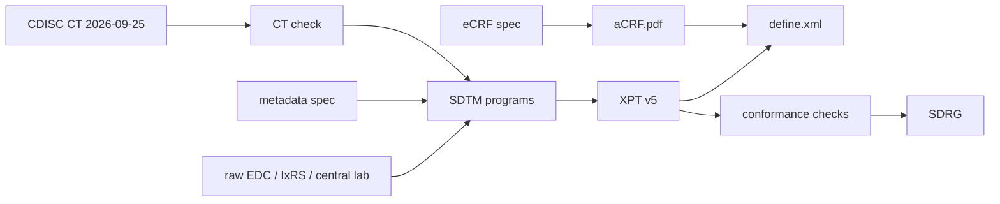

# ZX-201 SDTM Study Build: CDASH eCRF → raw EDC → SDTM → Define-XML

An end-to-end **SDTM tabulation package** for a simulated Phase II hypertension trial, built the way a sponsor or CRO clinical-programming team builds one: study set-up documents first, then a CDASH-aligned eCRF, a metadata specification, one mapping program per domain, and a submission package (SAS V5 XPT, Define-XML 2.1, annotated CRF, Study Data Reviewer's Guide) with independent conformance checks.

> **All data are simulated.** ZX-101 / ZX-201 are fictional. MedDRA- and WHODrug-style coding is illustrative (no licensed dictionaries). CDISC Controlled Terminology is the real NCI EVS release.

## What this demonstrates

| Area | Where |
|---|---|
| Trial set-up: protocol synopsis, schedule of assessments | [docs/protocol_synopsis.md](docs/protocol_synopsis.md) |
| **Data Flow Plan** (sources, vendors, hand-offs, controls, blinding) | [docs/data_flow_plan.md](docs/data_flow_plan.md) |
| **eCRF design (CDASH)**: fields, responses, edit checks | [specs/ecrf_spec.csv](specs/ecrf_spec.csv) |
| **Metadata specification**: datasets, variables, codelists, value-level metadata | [specs/sdtm_spec/](specs/sdtm_spec/) |
| **SDTM mapping** of 14 domains (TA TE TV TS DM SUPPDM SE SV CM EX AE DS LB VS) | [R/sdtm/](R/sdtm/) |
| **Controlled Terminology** validated against the real CDISC CT release | [R/01_ct_check.R](R/01_ct_check.R) |
| **Define-XML 2.1** with OID integrity checks + readable define.html | [R/10_define_xml.R](R/10_define_xml.R) |
| **Annotated CRF** (MSG-style annotations, PDF) | [R/11_annotated_crf.R](R/11_annotated_crf.R) |
| **Conformance checks**: 29 rules, every finding explained | [R/30_conformance_checks.R](R/30_conformance_checks.R) |
| **SDRG** (PHUSE cSDRG structure), tables generated from data | [docs/SDRG.md](docs/SDRG.md) |
| **GPP / GDP**: headers, spec-driven code, logrx logs, log scan, unit tests | [docs/programming_standards.md](docs/programming_standards.md) |

## Pipeline



## Realistic data problems the build has to handle

The simulator plants the issues real studies have, and the programs deal with each one explicitly:

| Issue in the source | How it is handled |
|---|---|
| EDC dates as `DD-MON-YYYY`, partial dates `UN-MAR-2025` | `raw_to_iso()` truncates to known precision, never imputes (unit-tested) |
| German sites collect birth **year** only | partial BRTHDTC; AGE taken from the collected field |
| Race collected as check-all-that-apply | RACE = `MULTIPLE` + SUPPDM RACE1/RACE2 |
| Triplicate seated BP on a horizontal CRF | transposed to VS with VSREPNUM 1-3 |
| Temperature in °F at US sites | standardised to °C in VSSTRESN |
| Lab vendor codes and conventional units; `<6` results; haemolysed samples | mapping table to LBTESTCD + SI conversion; `10^3/uL` mapped to its CT submission value `10^9/L`; `<x` kept in LBSTRESC; LBSTAT = NOT DONE |
| Blinded kit numbers on the CRF | EXTRT/EXDOSE from the unblinded IxRS kit list |
| Screen failures, a randomised-never-dosed subject, a death | ARMNRS, RFSTDTC rules, DTHFL / AESDTH / DS consistency |
| AE end date before start (open query), weight entered in lb | detected by conformance rules, submitted as collected, explained in the SDRG |
| RACE/ETHNIC codelists absent from the current CT release | flagged by the CT check and documented in the SDRG |

## Results (current build)

- 200 screened / 180 randomised / 179 dosed; 14 datasets, about 21,700 records
- CT check: 89 terms resolved to NCI codes, 0 errors
- define.xml: 233 ItemDefs, 41 CodeLists, 90 MethodDefs, 13 value-level items, **24/24 integrity checks pass**
- Conformance: **24/29 rules pass**; the 5 others are the planted data issues above, each explained in [SDRG §4](docs/SDRG.md#4-data-conformance-summary)
- 15 programs, logrx logs, **0 errors / 0 warnings**; 23 unit tests pass

## Run it

Requires R ≥ 4.3 and Edge or Chrome (used headless to print the aCRF PDF).

```bash
Rscript -e "install.packages(c('dplyr','tidyr','stringr','purrr','readr','tibble','haven','xml2','commonmark','logrx','testthat'))"
```
```bash
Rscript run_all.R
```
```bash
Rscript tests/run_tests.R
```

## Outputs

| File | Description |
|---|---|
| `output/sdtm/*.xpt` | SAS V5 transport files, one per domain |
| `output/sdtm/define.xml`, `define.html` | Define-XML 2.1 and its readable rendering |
| `output/sdtm/acrf.pdf` | Annotated CRF |
| `output/sdtm/sdrg.html`, `docs/SDRG.md` | Study Data Reviewer's Guide |
| `output/metadata/conformance_report.csv` | Rule-level results; `conformance_issues.csv` has record-level findings |
| `output/metadata/ct_check_report.csv` | CT validation results |
| `logs/*.log` | logrx execution logs |

## Repository layout

```
data/raw/            simulated source extracts (EDC, IxRS, central lab, coding)
specs/               eCRF spec, SDTM metadata spec, visit schedule, lab mapping, trial design, pinned CDISC CT
R/utils/             shared, unit-tested helpers
R/sdtm/              one program per domain
R/0x-4x_*.R          simulation, CT check, define, aCRF, conformance, SDRG
docs/                protocol synopsis, data flow plan, programming standards, SDRG
output/              XPT, define, aCRF, SDRG, metadata reports
tests/               testthat unit tests
```

## Standards
SDTM v2.0 · SDTMIG v3.4 · CDASH-aligned eCRF · Define-XML v2.1 · CDISC CT (NCI EVS, 2026-09-25) · PHUSE cSDRG template structure.

## Companion project
[`adam-tfl-cdisc-pilot`](https://github.com/arjun93005/adam-tfl-cdisc-pilot) continues downstream: ADaM with `{admiral}`, TFLs, independent double-programming QC, a ClinicalTrials.gov results package and a Health Authority query response, built on the public CDISC Pilot data.
