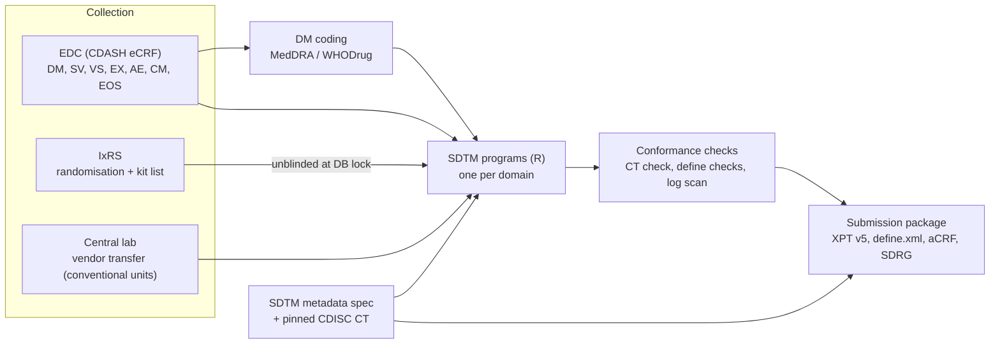

# Data Flow Plan - ZX-201

| | |
|---|---|
| Document | Data Flow Plan (DFP) |
| Study | ZX-201 (simulated) |
| Version | 1.0 |
| Owner | Clinical Programming |

## 1. Purpose
Describes every source of study data, how it moves from collection to submission-ready SDTM, who owns each step, and the checks applied at each hand-off. It is agreed before first-patient-in so that the eCRF, vendor data transfer specifications and SDTM specification are designed together.

## 2. Data flow

## 3. Data sources

| Source | Provider | Format | Frequency | SDTM domains | Transfer spec |
|---|---|---|---|---|---|
| EDC form extracts | EDC vendor | CSV, CDASH field names, DD-MON-YYYY dates | Weekly + final at lock | DM, SUPPDM, SV, VS, EX, AE, CM, DS | `specs/ecrf_spec.csv` |
| Randomisation list | IxRS vendor | CSV, ISO dates | At lock (unblinded) | DM (ARMCD/ARM), DS (RANDOMIZED) | n/a |
| Kit list | IxRS vendor | CSV | At lock (unblinded) | EX (EXTRT, EXDOSE), DM (ACTARMCD) | n/a |
| Central laboratory | Lab vendor | CSV, vendor test codes, conventional units | Monthly + final | LB | `specs/lab_test_mapping.csv` |
| AE / CM coding | Data Management | CSV coding export | With each EDC extract | AE, CM | Coding conventions |
| Protocol | Clinical | Document | Per amendment | TA, TE, TV, TS | `specs/trial_design/`, `specs/visit_schedule.csv` |

## 4. Processing steps and controls

| Step | Program / owner | Control |
|---|---|---|
| Receive extracts | `data/raw/` | Row counts logged; files never edited by hand |
| CT validation | `R/01_ct_check.R` | Spec codelists checked against the pinned NCI EVS CT file; non-extensible violations stop the build |
| SDTM mapping | `R/sdtm/*.R` | Unmapped CRF responses, uncoded terms, unknown kits, unexpected vendor units and duplicate coding keys all **stop** the program rather than pass through |
| Attribute assignment | `write_domain()` | Variables, order, labels, types and lengths come only from the spec; undocumented variables stop the build |
| Define-XML | `R/10_define_xml.R` | Referential integrity of all OIDs; define vs XPT variable match |
| aCRF | `R/11_annotated_crf.R` | PDF page count must equal the page numbers used in define.xml |
| Conformance | `R/30_conformance_checks.R` | 29 rules; every non-pass explained in the SDRG |
| Logs | `run_all.R` | logrx logs per program; any error or warning fails the run |

## 5. Blinding
Treatment assignment (IxRS randomisation and kit lists) is received only after database lock. Before lock, SDTM programs are developed and tested with dummy randomisation so that blinded team members never see actual assignments.

## 6. Known data-handling decisions
See SDRG section 3.3 (partial dates, triplicate BP, temperature units, lab unit synonyms, screen failures, randomised-not-treated subject).
